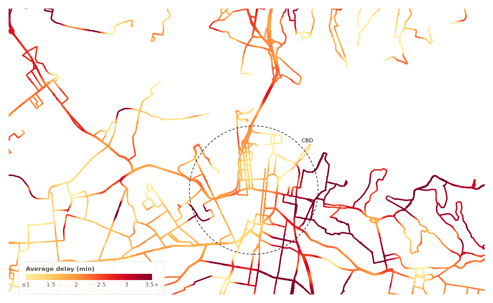
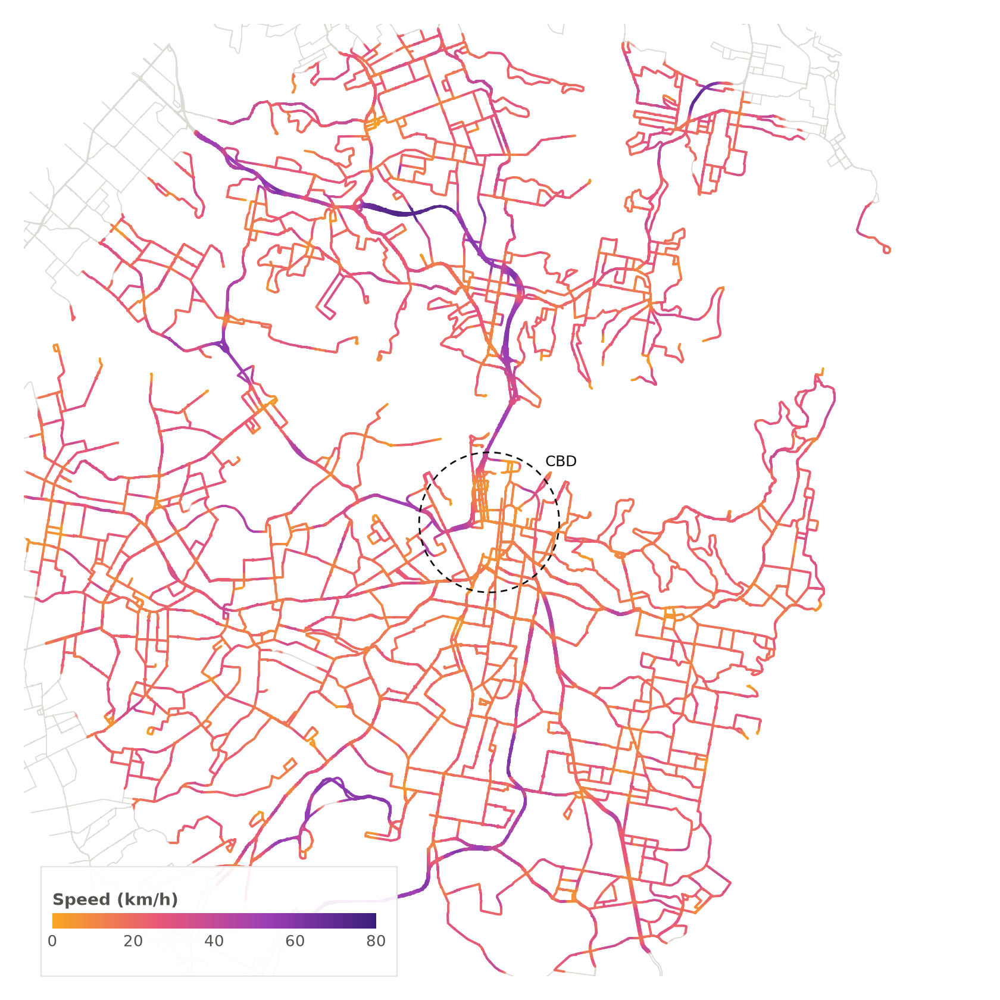
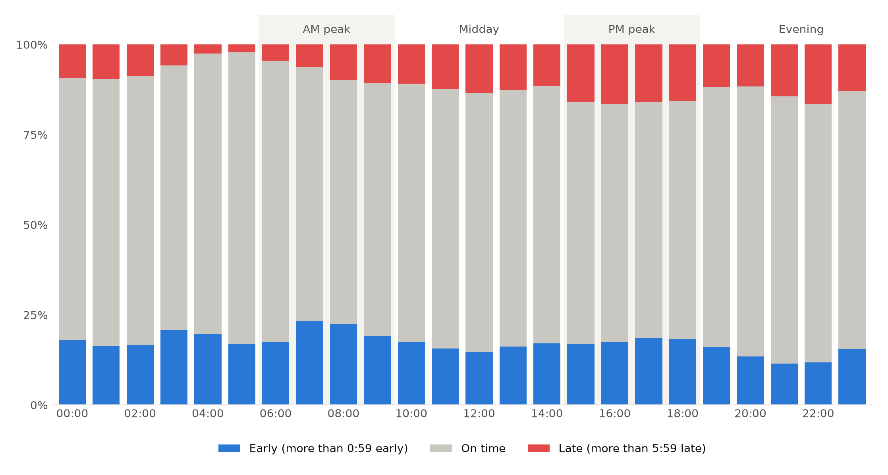
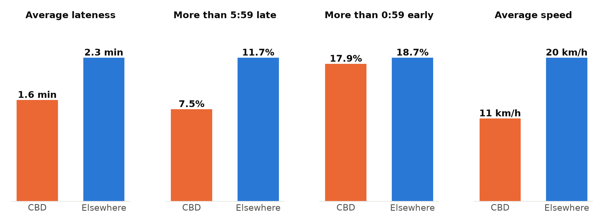
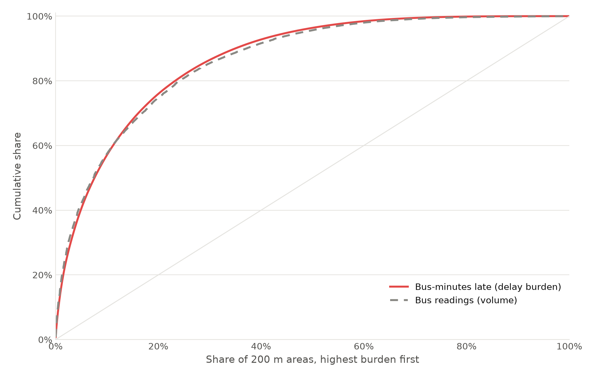
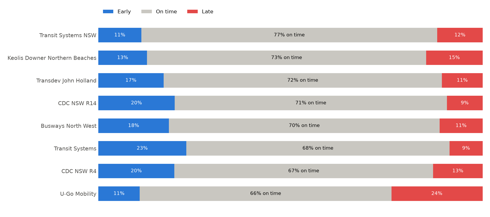
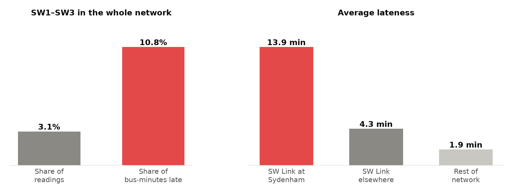
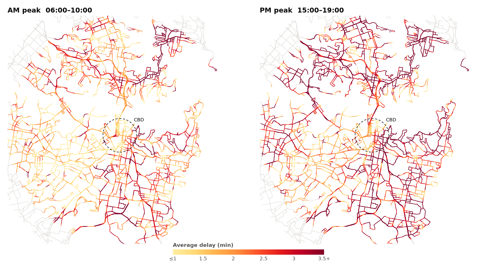
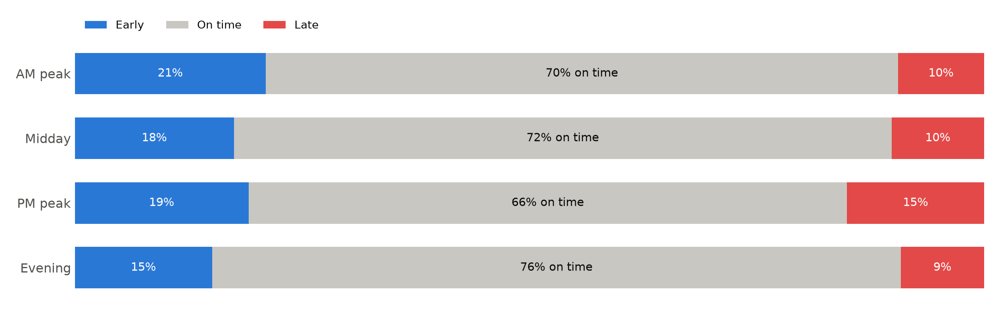
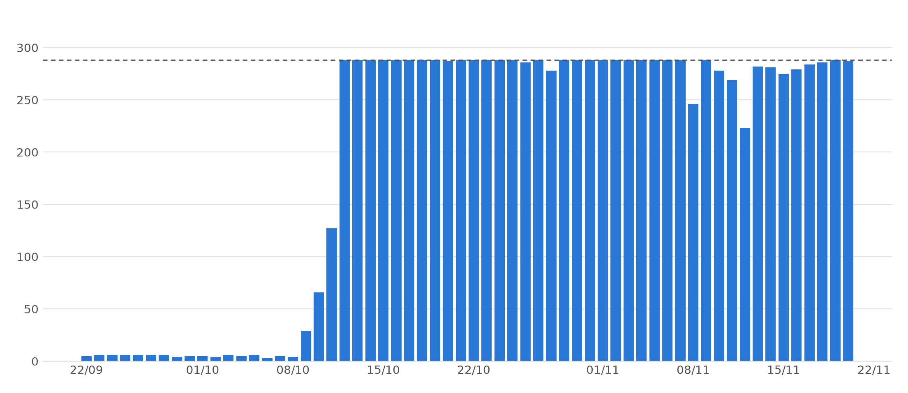

# CIVL3704 presentation charts

Built 2026-11-21 00:01 UTC from 2026-11-15 00:02 to 2026-11-21 10:17 (Sydney) (691,757 delay readings, 1,808 snapshots). Rebuilt daily by `.github/workflows/analysis.yml` on main; download a PNG by opening it and choosing *Download raw file*.

## Headline numbers

- Network: **70.6% on time**, 18.5% early, 10.9% late; mean lateness 2.2 min (Southwest Link excluded)
- CBD (≤1.5 km of Town Hall): 1.65 min average lateness, 7.5% late, 11.3 km/h — elsewhere 2.34 min, 11.7% late, 19.6 km/h
- CBD holds 19.3% of readings and 14.5% of bus-minutes late
- Top 5% of 200 m areas hold 40.2% of burden and 42.0% of readings
- AM peak: 70.5% on time, 20.4% early, 9.1% late
- Midday: 72.1% on time, 17.8% early, 10.1% late
- PM peak: 66.2% on time, 19.3% early, 14.5% late
- Evening: 75.8% on time, 15.5% early, 8.7% late
- AM peak, weekdays only: 69.5% on time, 21.0% early, 9.5% late, mean lateness 1.98 min
- Midday, weekdays only: 72.3% on time, 17.5% early, 10.2% late, mean lateness 2.14 min
- PM peak, weekdays only: 65.8% on time, 19.1% early, 15.1% late, mean lateness 2.69 min
- Evening, weekdays only: 75.7% on time, 15.1% early, 9.2% late, mean lateness 2.06 min
- Operators read 21.2–29.4 points below published OTR (Aug 2026); Spearman ρ = -0.41
- Southwest Link (11/10–16/10): 3.1% of readings, 10.8% of lateness; 13.9 min late at Sydenham (78.1% stationary) vs 4.31 min elsewhere

### Highest average delay

1. Darling St before Elliott St: 7.2 min (291 readings, 48.8% stationary)
2. Greenknowe Ave at Baroda St: 5.3 min (244 readings, 31.6% stationary)
3. Spit Rd before Medusa St: 4.5 min (281 readings, 7.8% stationary)
4. Pacific Hwy at Allison Ave: 4.4 min (220 readings, 22.7% stationary)
5. Canterbury Rd opp Saint Mary MacKi…: 4.3 min (250 readings, 22.4% stationary)
6. Boundary St before Archer St: 4.3 min (506 readings, 50.6% stationary)

### Highest delay burden

1. Hyde Park: 1,868 bus-minutes late per day (5,978 readings)
2. Spit Junction: 1,466 bus-minutes late per day (2,747 readings)
3. Bondi Junction Station: 1,201 bus-minutes late per day (8,025 readings)
4. Neutral Bay Junction: 831 bus-minutes late per day (1,702 readings)
5. Broadway Shopping Centre: 812 bus-minutes late per day (3,096 readings)
6. Falcon St at Alexander St: 731 bus-minutes late per day (1,345 readings)

## Charts

### map_average_delay_area.png

### map_average_delay_model.png

### map_delay_burden.png

### map_not_on_time.png

### map_speed.png

### otr_by_hour.png

### cbd_vs_elsewhere.png

### burden_concentration.png

### otr_vs_published.png

### otr_by_operator.png

### southwest_link_artefact.png

### map_average_delay_peaks.png

### map_average_delay_periods.png

### otr_by_period.png

### collection_per_day.png

