# CIVL3704 presentation charts

Built 2026-11-13 23:34 UTC from 2026-11-08 00:02 to 2026-11-14 10:02 (Sydney) (623,482 delay readings, 1,702 snapshots). Rebuilt daily by `.github/workflows/analysis.yml` on main; download a PNG by opening it and choosing *Download raw file*.

## Headline numbers

- Network: **69.7% on time**, 20.1% early, 10.3% late; mean lateness 2.09 min (Southwest Link excluded)
- CBD (≤1.5 km of Town Hall): 1.48 min average lateness, 6.5% late, 11.4 km/h — elsewhere 2.24 min, 11.2% late, 19.8 km/h
- CBD holds 19.0% of readings and 13.4% of bus-minutes late
- Top 5% of 200 m areas hold 40.3% of burden and 41.6% of readings
- AM peak: 68.6% on time, 24.1% early, 7.3% late
- Midday: 70.8% on time, 19.3% early, 9.9% late
- PM peak: 66.1% on time, 19.9% early, 14.0% late
- Evening: 75.5% on time, 16.2% early, 8.3% late
- AM peak, weekdays only: 67.4% on time, 25.1% early, 7.5% late, mean lateness 1.65 min
- Midday, weekdays only: 71.0% on time, 19.4% early, 9.6% late, mean lateness 2.04 min
- PM peak, weekdays only: 65.9% on time, 19.7% early, 14.5% late, mean lateness 2.61 min
- Evening, weekdays only: 75.3% on time, 16.0% early, 8.8% late, mean lateness 1.97 min
- Operators read 16.3–26.8 points below published OTR (Aug 2026); Spearman ρ = -0.35
- Southwest Link (11/10–16/10): 3.1% of readings, 10.8% of lateness; 13.9 min late at Sydenham (78.1% stationary) vs 4.31 min elsewhere

### Highest average delay

1. Manly Rd at Heaton Ave: 4.6 min (340 readings, 10.6% stationary)
2. Spit Rd at Stanton Rd: 4.5 min (249 readings, 4.8% stationary)
3. Sydney Rd at Condamine St: 4.3 min (640 readings, 31.2% stationary)
4. Boundary St before Archer St: 4.1 min (491 readings, 44.6% stationary)
5. Burns Bay Rd after Penrose St: 4.0 min (316 readings, 56.6% stationary)
6. Bellevue Rd at New South Head Rd: 3.9 min (245 readings, 36.7% stationary)

### Highest delay burden

1. Hyde Park: 1,392 bus-minutes late per day (4,904 readings)
2. Spit Junction: 1,335 bus-minutes late per day (2,512 readings)
3. Bondi Junction Station: 1,209 bus-minutes late per day (7,784 readings)
4. Burwood Station: 774 bus-minutes late per day (1,840 readings)
5. Westfield Eastgardens: 754 bus-minutes late per day (2,235 readings)
6. Neutral Bay Junction: 729 bus-minutes late per day (1,619 readings)

## Charts

### map_average_delay_area.png

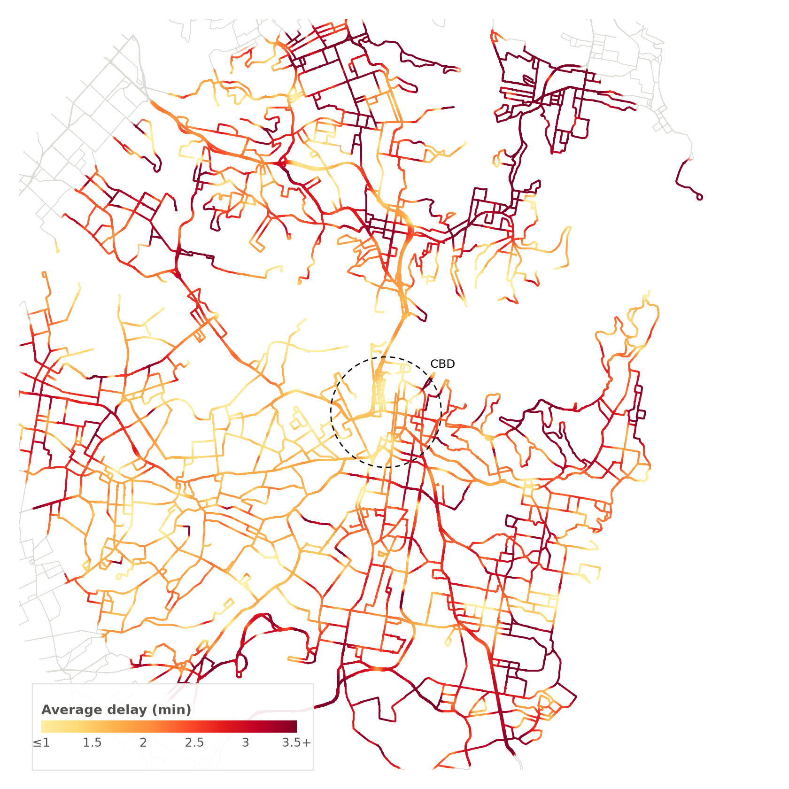

### map_average_delay_model.png

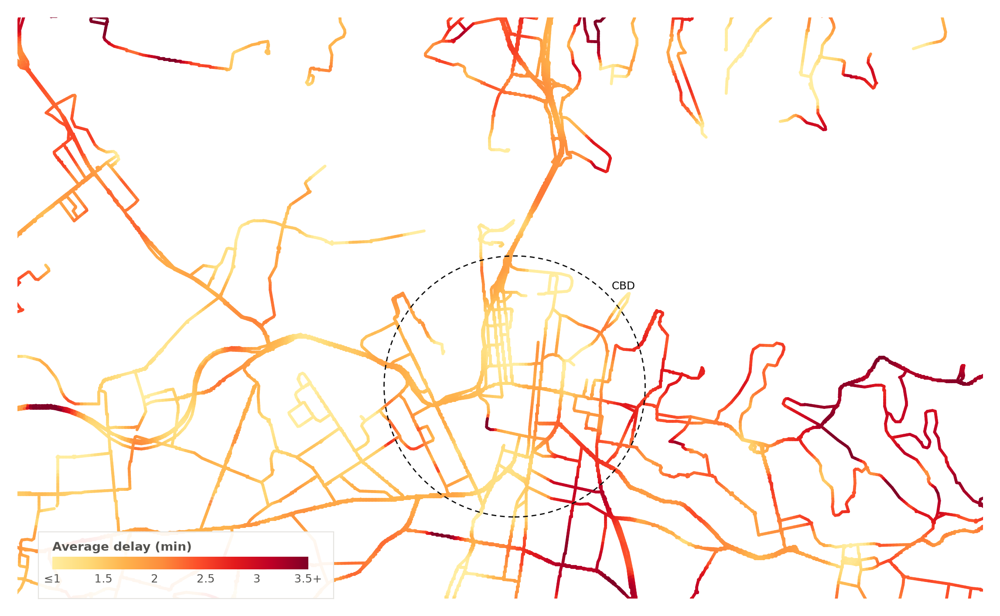

### map_delay_burden.png

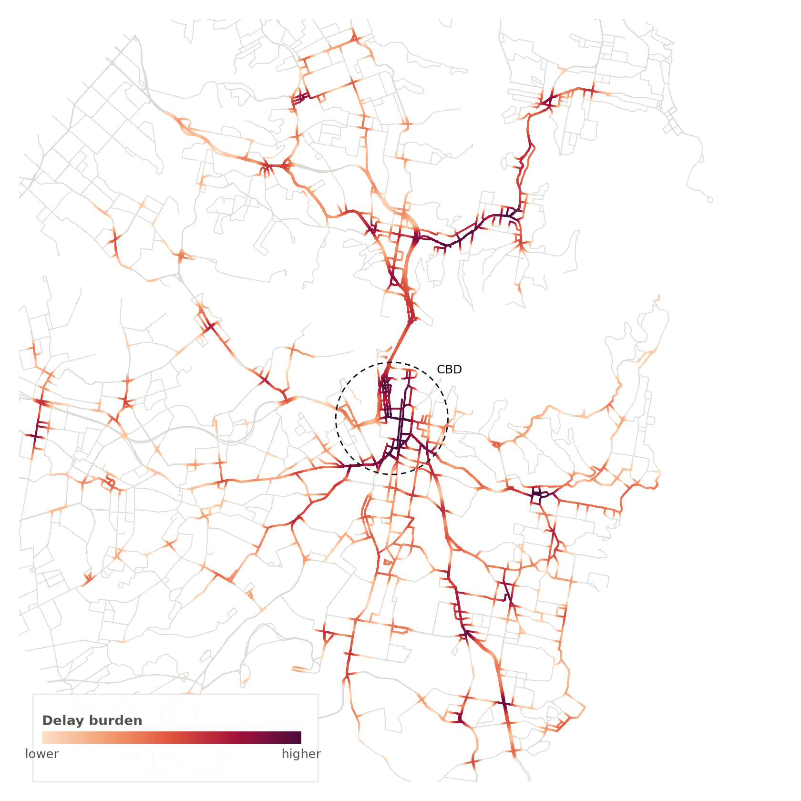

### map_not_on_time.png

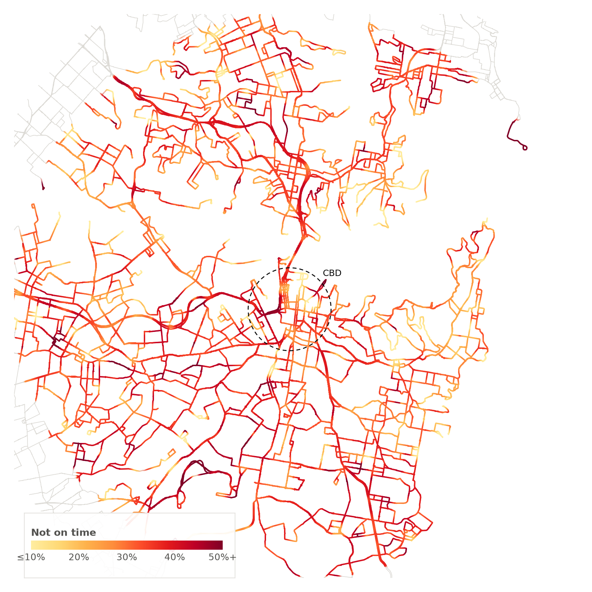

### map_speed.png

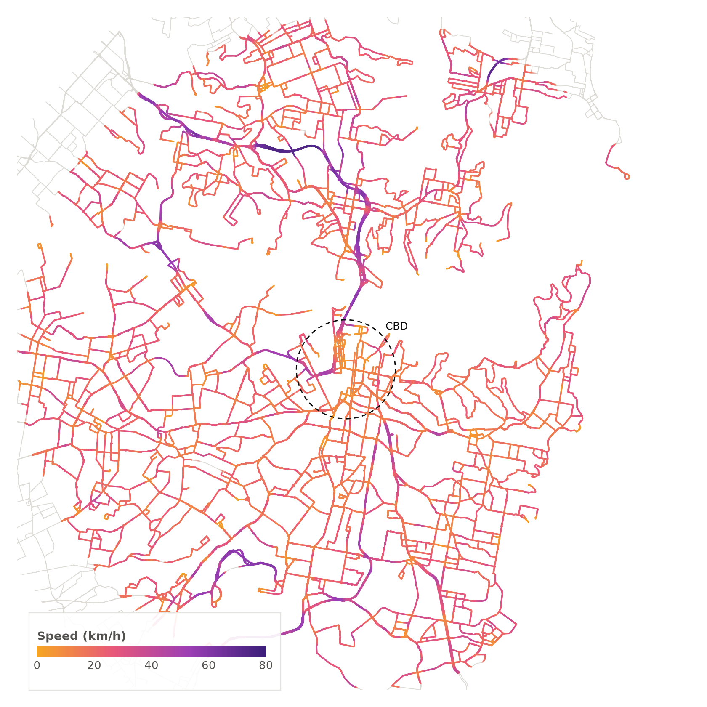

### otr_by_hour.png

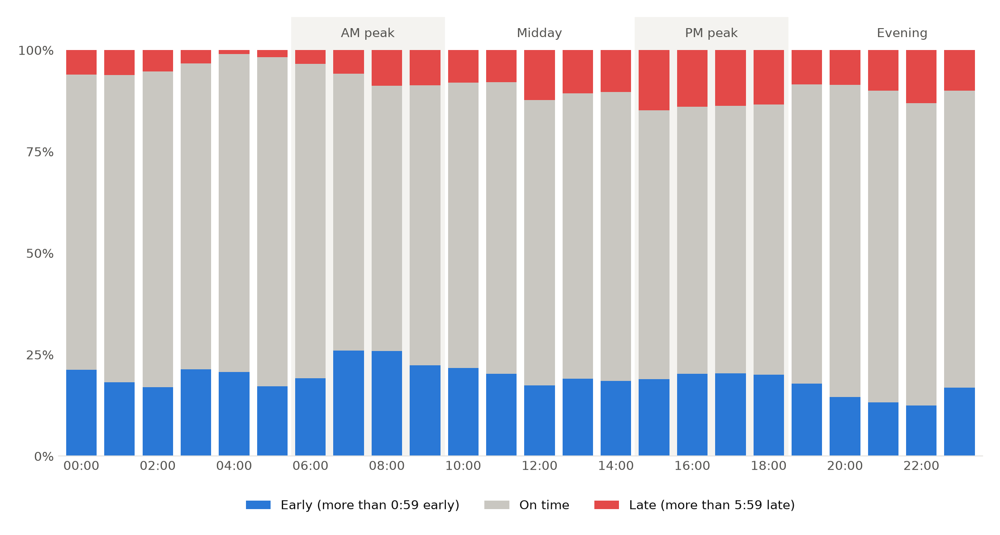

### cbd_vs_elsewhere.png

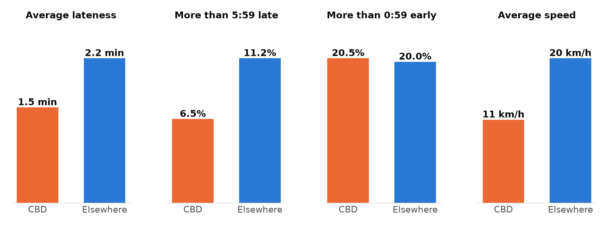

### burden_concentration.png

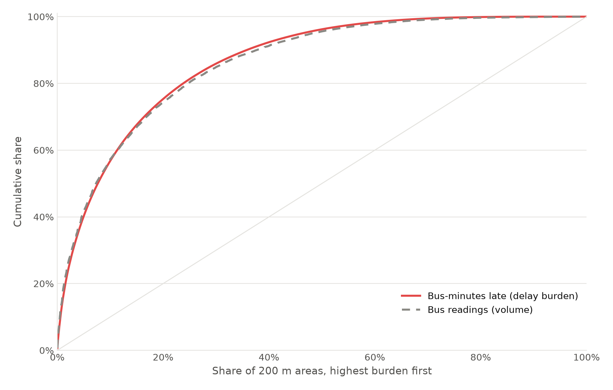

### otr_vs_published.png

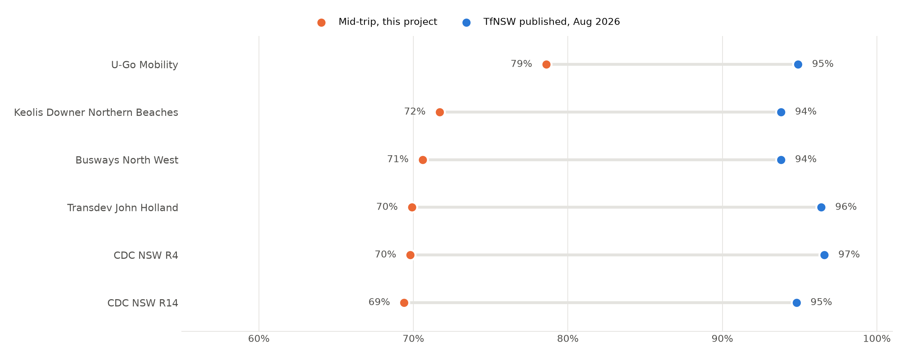

### otr_by_operator.png

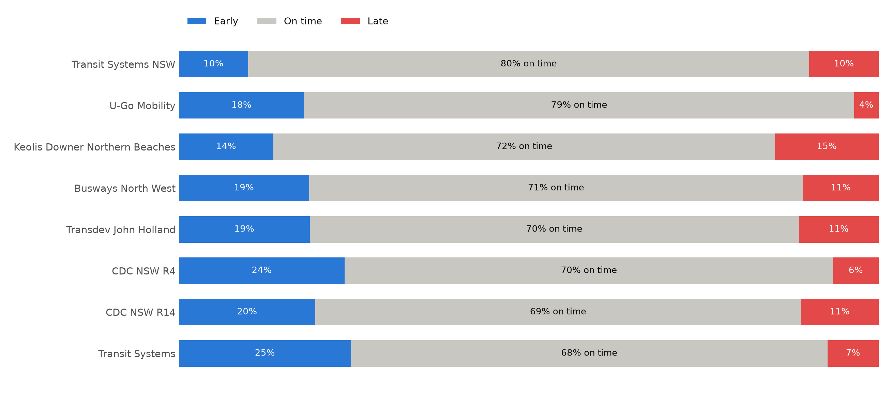

### southwest_link_artefact.png

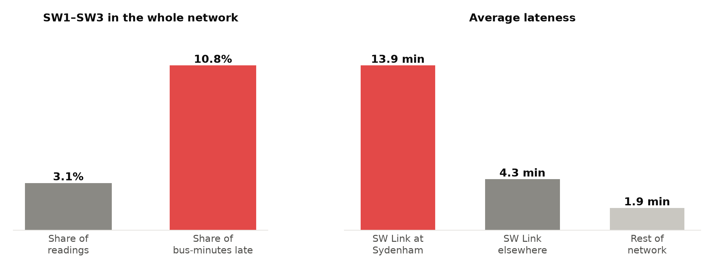

### map_average_delay_peaks.png

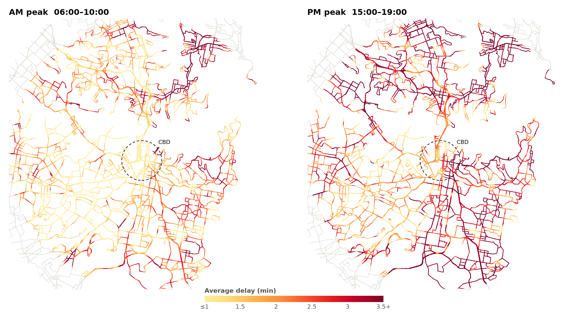

### map_average_delay_periods.png

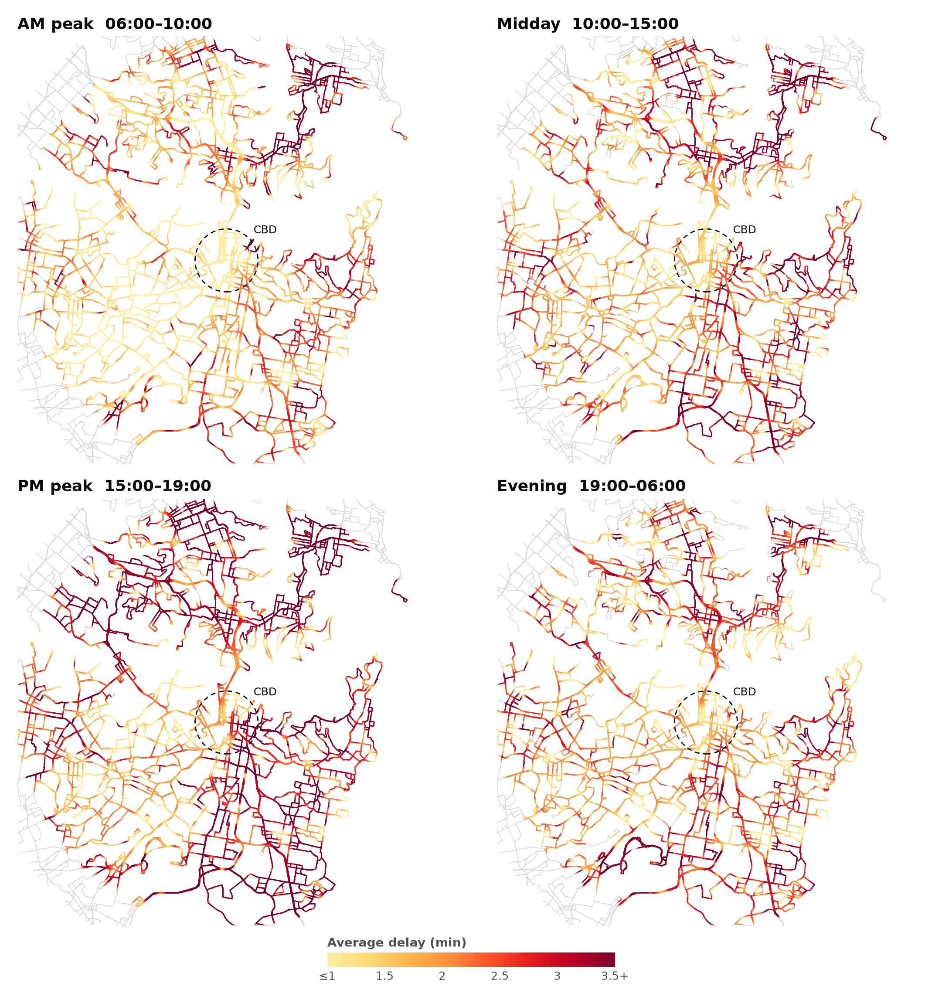

### otr_by_period.png

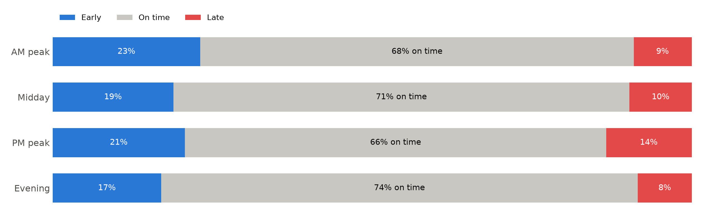

### collection_per_day.png

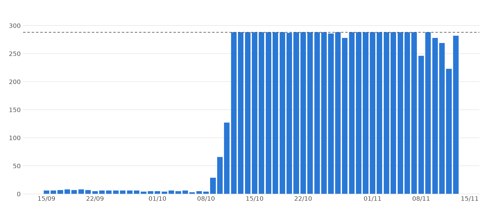
