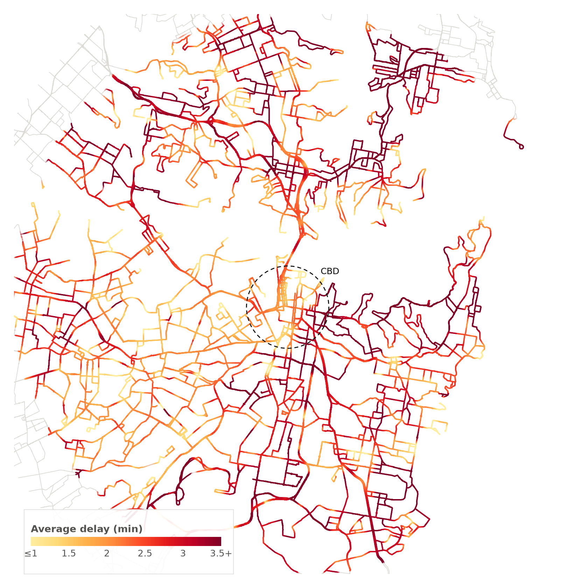
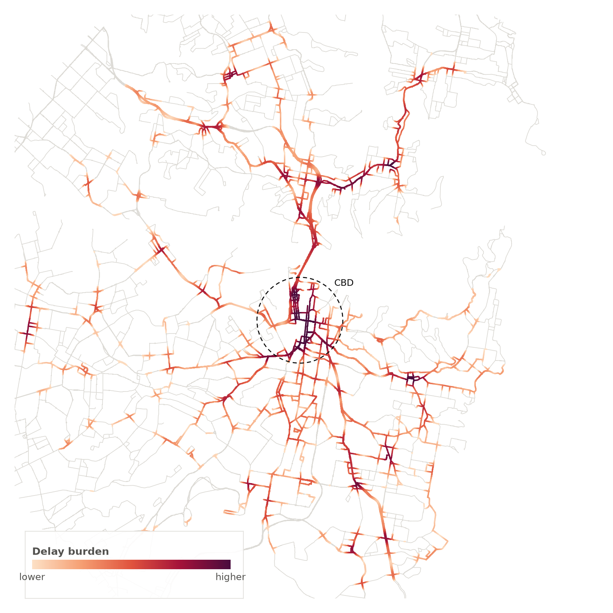
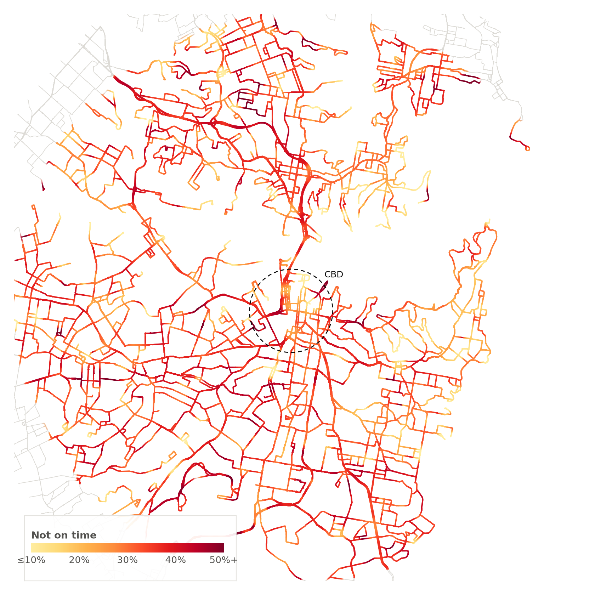
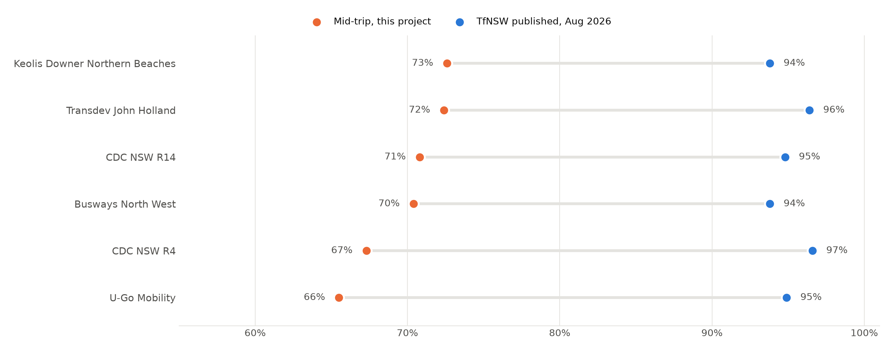
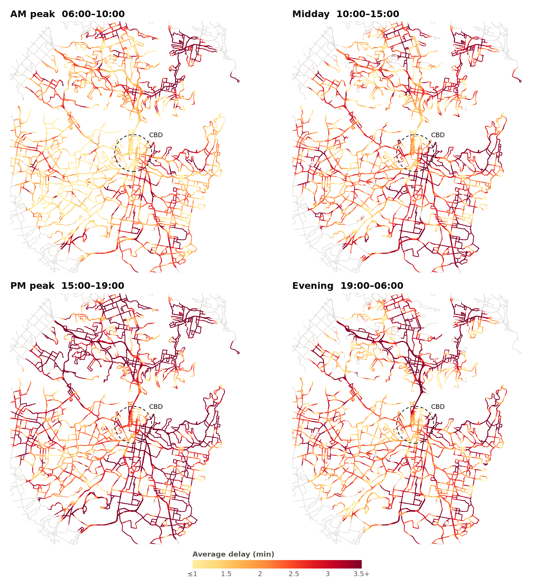

# CIVL3704 presentation charts

Built 2026-11-28 01:30 UTC from 2026-11-22 00:02 to 2026-11-28 11:32 (Sydney) (724,256 delay readings, 1,856 snapshots). Rebuilt daily by `.github/workflows/analysis.yml` on main; download a PNG by opening it and choosing *Download raw file*.

## Headline numbers

- Network: **70.1% on time**, 17.8% early, 12.2% late; mean lateness 2.38 min (Southwest Link excluded)
- CBD (≤1.5 km of Town Hall): 1.85 min average lateness, 8.9% late, 11.2 km/h — elsewhere 2.51 min, 12.9% late, 19.5 km/h
- CBD holds 19.4% of readings and 15.1% of bus-minutes late
- Top 5% of 200 m areas hold 40.6% of burden and 42.2% of readings
- AM peak: 70.4% on time, 21.2% early, 8.4% late
- Midday: 71.6% on time, 16.3% early, 12.1% late
- PM peak: 66.1% on time, 17.8% early, 16.1% late
- Evening: 73.9% on time, 14.9% early, 11.2% late
- AM peak, weekdays only: 69.6% on time, 21.9% early, 8.5% late, mean lateness 1.82 min
- Midday, weekdays only: 72.0% on time, 16.8% early, 11.2% late, mean lateness 2.28 min
- PM peak, weekdays only: 65.8% on time, 17.9% early, 16.3% late, mean lateness 2.89 min
- Evening, weekdays only: 73.8% on time, 14.6% early, 11.7% late, mean lateness 2.37 min
- Operators read 21.4–30.5 points below published OTR (Aug 2026); Spearman ρ = -0.61
- Southwest Link (11/10–16/10): 3.1% of readings, 10.8% of lateness; 13.9 min late at Sydenham (78.1% stationary) vs 4.31 min elsewhere

### Highest average delay

1. Greenknowe Ave at Baroda St: 5.6 min (240 readings, 31.7% stationary)
2. Botany Rd at Daphne St: 5.1 min (251 readings, 20.3% stationary)
3. Birriga Rd after Old South Head Rd: 4.8 min (381 readings, 55.4% stationary)
4. Woollahra Shops: 4.7 min (277 readings, 23.1% stationary)
5. Spit Rd before Medusa St: 4.7 min (261 readings, 8.8% stationary)
6. UNSW Gate 2: 4.6 min (216 readings, 7.9% stationary)

### Highest delay burden

1. Hyde Park: 2,061 bus-minutes late per day (6,066 readings)
2. Spit Junction: 1,600 bus-minutes late per day (2,937 readings)
3. Bondi Junction Station: 1,478 bus-minutes late per day (8,178 readings)
4. Neutral Bay Junction: 967 bus-minutes late per day (1,832 readings)
5. Westfield Eastgardens: 870 bus-minutes late per day (2,719 readings)
6. Broadway Shopping Centre: 858 bus-minutes late per day (3,112 readings)

## Charts

### map_average_delay_area.png

### map_average_delay_model.png

### map_delay_burden.png

### map_not_on_time.png

### map_speed.png

### otr_by_hour.png

### cbd_vs_elsewhere.png

### burden_concentration.png

### otr_vs_published.png

### otr_by_operator.png

### southwest_link_artefact.png

### map_average_delay_peaks.png

### map_average_delay_periods.png

### otr_by_period.png

### collection_per_day.png

