# CIVL3704 presentation charts

Built 2026-10-23 21:25 UTC from 2026-10-18 00:02 to 2026-10-24 07:42 (Sydney) (686,163 delay readings, 1,820 snapshots). Rebuilt daily by `.github/workflows/analysis.yml` on main; download a PNG by opening it and choosing *Download raw file*.

## Headline numbers

- Network: **70.9% on time**, 20.7% early, 8.4% late; mean lateness 1.84 min (Southwest Link excluded)
- CBD (≤1.5 km of Town Hall): 1.31 min average lateness, 5.3% late, 11.5 km/h — elsewhere 1.97 min, 9.1% late, 19.6 km/h
- CBD holds 19.0% of readings and 13.4% of bus-minutes late
- Top 5% of 200 m areas hold 39.6% of burden and 41.6% of readings
- AM peak: 69.5% on time, 23.5% early, 7.0% late
- Midday: 72.0% on time, 20.0% early, 8.0% late
- PM peak: 68.4% on time, 20.9% early, 10.6% late
- Evening: 75.5% on time, 17.4% early, 7.1% late
- AM peak, weekdays only: 69.0% on time, 23.7% early, 7.3% late, mean lateness 1.66 min
- Midday, weekdays only: 72.0% on time, 20.0% early, 8.0% late, mean lateness 1.86 min
- PM peak, weekdays only: 68.0% on time, 21.0% early, 11.0% late, mean lateness 2.12 min
- Evening, weekdays only: 75.8% on time, 17.0% early, 7.2% late, mean lateness 1.76 min
- Operators read 16.9–27.9 points below published OTR (Aug 2026); Spearman ρ = -0.23
- Southwest Link (11/10–16/10): 3.1% of readings, 10.8% of lateness; 13.9 min late at Sydenham (78.1% stationary) vs 4.31 min elsewhere

### Highest average delay

1. Pacific Hwy opp Cobden Ave: 4.2 min (354 readings, 26.8% stationary)
2. Boundary St before Archer St: 4.1 min (511 readings, 43.8% stationary)
3. Wentworth Ave at Merchant St: 3.9 min (290 readings, 60.0% stationary)
4. Spit West Reserve: 3.7 min (457 readings, 15.8% stationary)
5. Sydney Rd at Wanganella St: 3.7 min (371 readings, 25.1% stationary)
6. Spit Rd at Stanton Rd: 3.5 min (231 readings, 13.9% stationary)

### Highest delay burden

1. Bondi Junction Station: 1,259 bus-minutes late per day (9,028 readings)
2. Hyde Park: 1,230 bus-minutes late per day (5,121 readings)
3. Spit Junction: 1,227 bus-minutes late per day (2,754 readings)
4. Broadway Shopping Centre: 786 bus-minutes late per day (3,111 readings)
5. Neutral Bay Junction: 739 bus-minutes late per day (1,717 readings)
6. Burwood Station: 680 bus-minutes late per day (1,923 readings)

## Charts

### map_average_delay_area.png

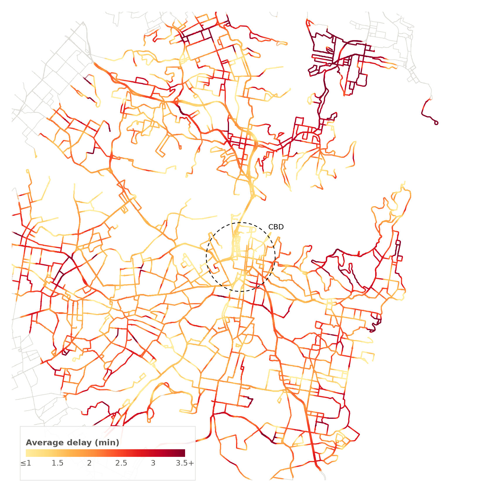

### map_average_delay_model.png

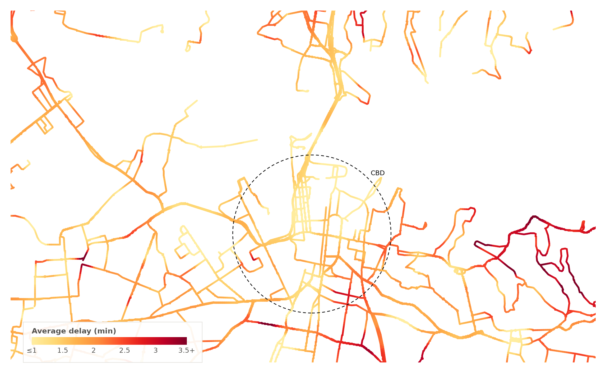

### map_delay_burden.png

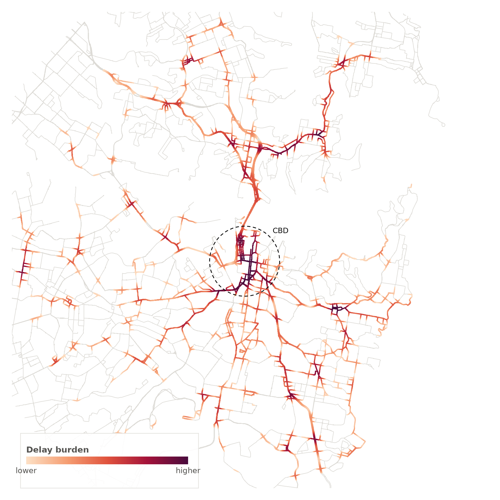

### map_not_on_time.png

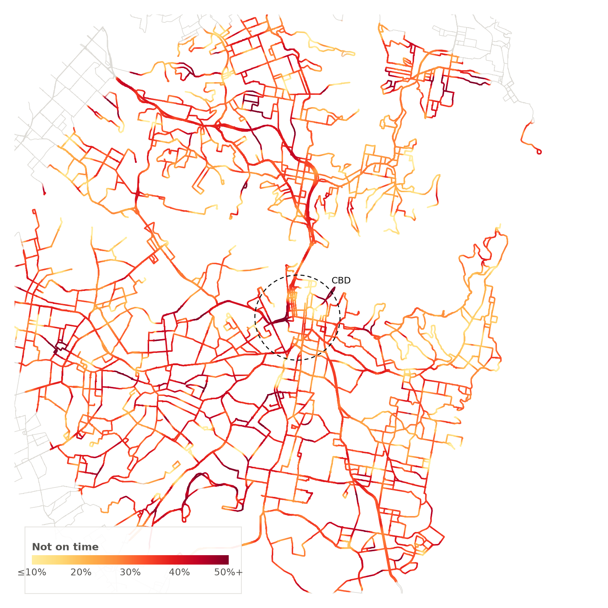

### map_speed.png

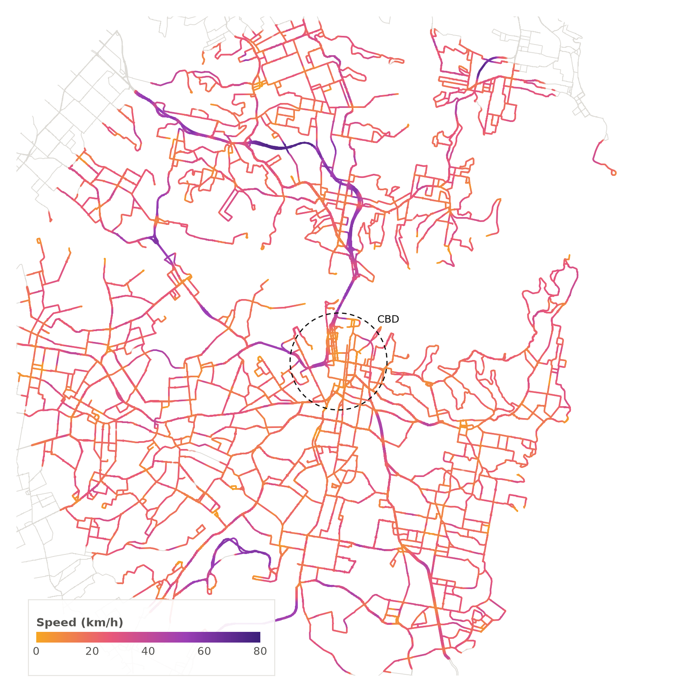

### otr_by_hour.png

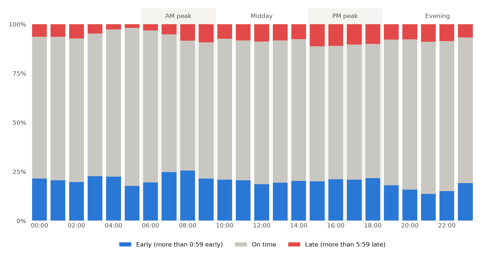

### cbd_vs_elsewhere.png

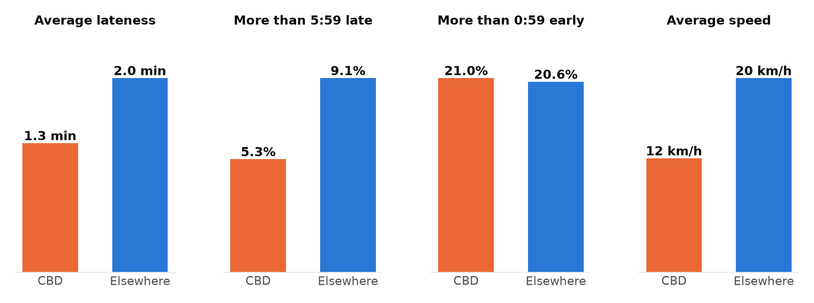

### burden_concentration.png

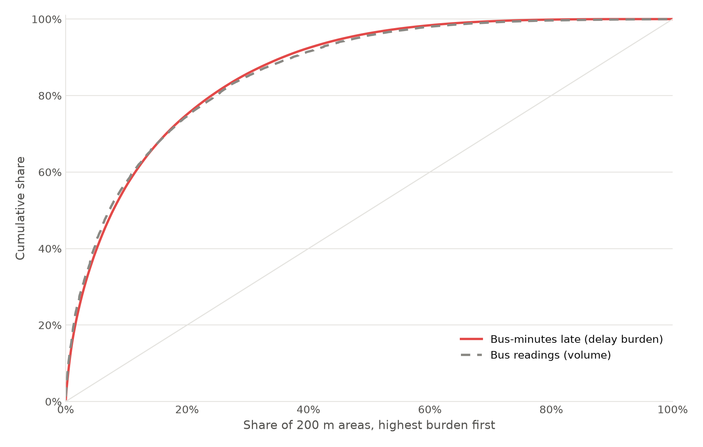

### otr_vs_published.png

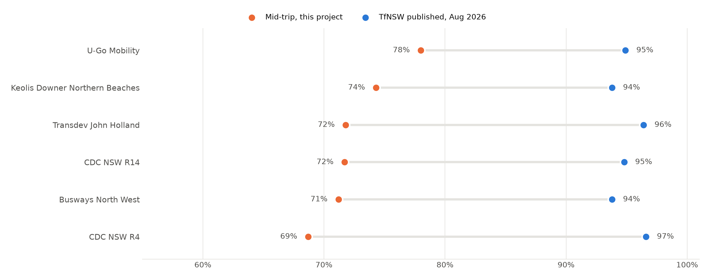

### otr_by_operator.png

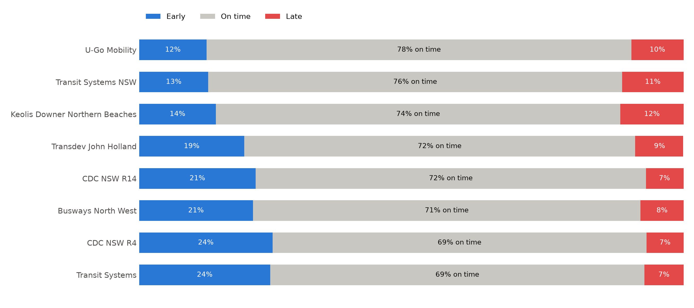

### southwest_link_artefact.png

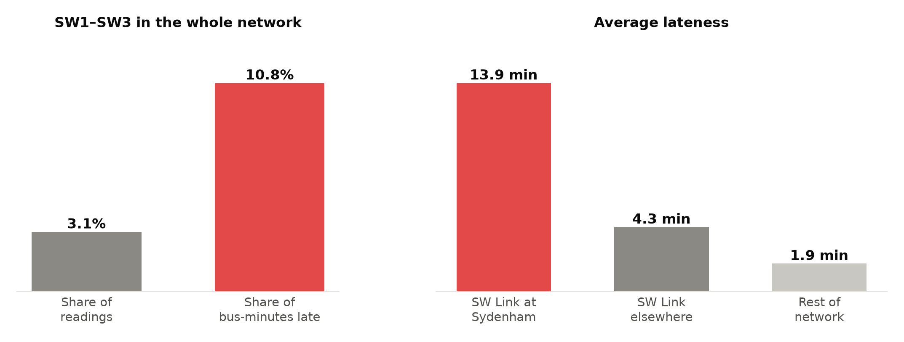

### map_average_delay_peaks.png

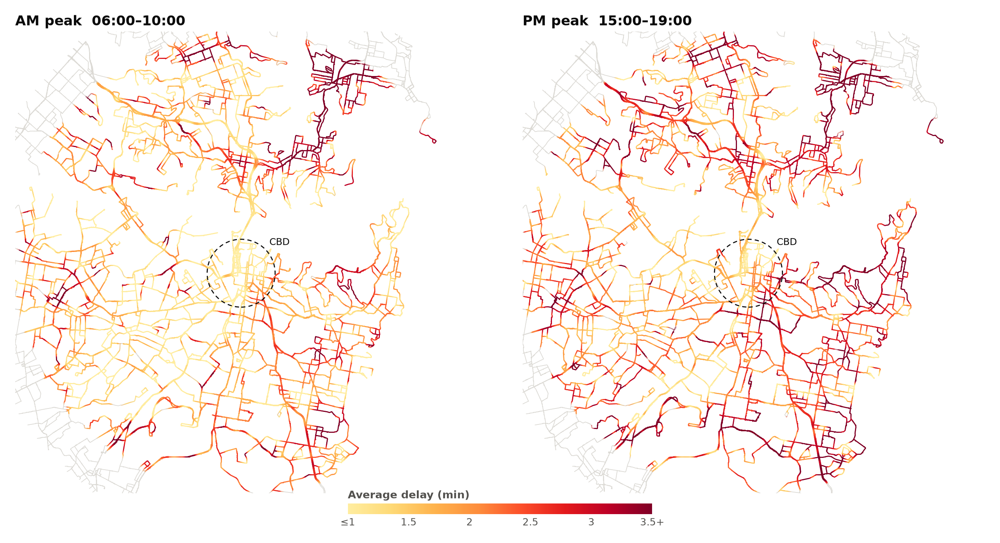

### map_average_delay_periods.png

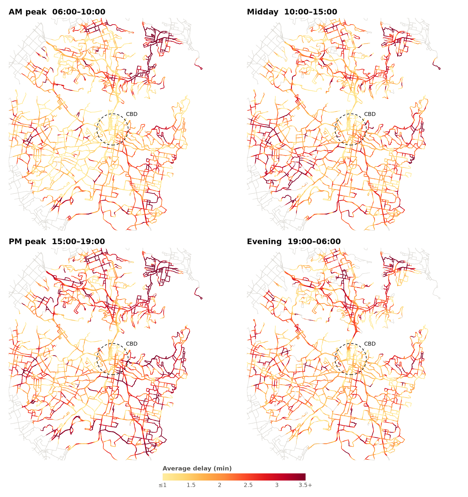

### otr_by_period.png

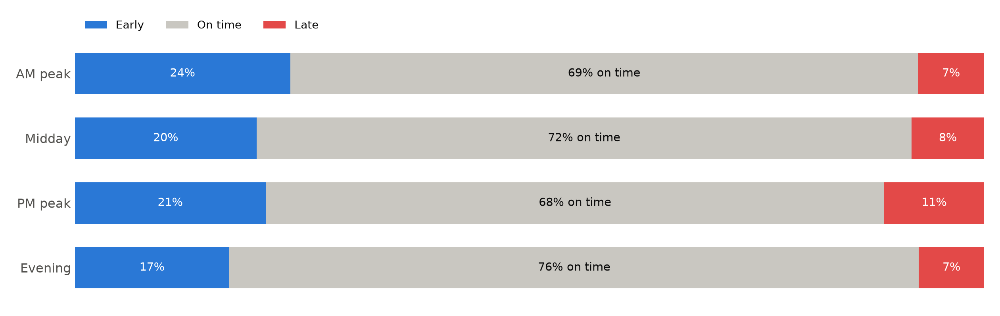

### collection_per_day.png

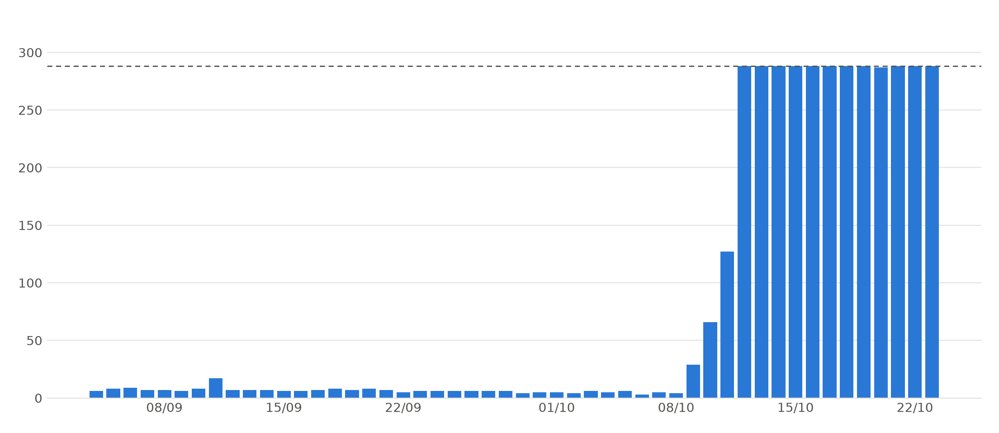
